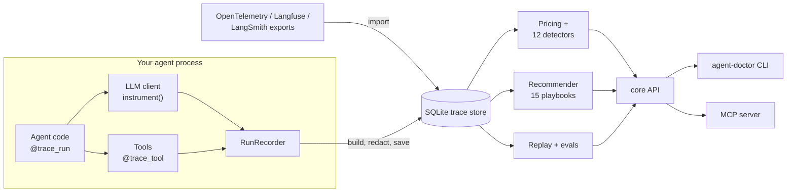

# Agent Doctor

**Find out why your AI agent is expensive, slow or unreliable, and how to fix it.**

[](https://pypi.org/project/agent-doctor-cli/)
[](https://pypi.org/project/agent-doctor-cli/)
[](LICENSE)

Agent Doctor records every step of an agent run (LLM calls, tool calls, retries, errors),
detects wasted cost and time, recommends concrete fixes, and lets you prove a fix works
before you ship it. It runs entirely on your machine, and its analysis uses no LLM calls,
so it is free, fast and repeatable.

```
$ agent-doctor analyze last
run_dc3352eba323  agent support-bot  ok  3.93 s  3 LLM / 6 tool calls  $0.0135
5 finding(s).  Estimated waste: ~$0.009369, 1.12 s, 5,812 tok

| 1 | medium | Prompt grew 2.9x over 3 LLM calls (1,095 to 3,141 tokens)     | #2, #5, #9 |
| 2 | medium | Prompt caching is broken by text that changes at the start     | #2, #5, #9 |
| 3 | medium | get_tracking failed 2x and was retried with no backoff         | #6, #7, #8 |
| 4 | medium | search_orders called 2x with the same arguments                | #3, #4     |
| 5 | medium | demo-large used for a 3-token answer                           | #2         |
```

## Contents

- [Features](#features)
- [Installation](#installation)
- [Quick start](#quick-start)
- [Recording your agent](#recording-your-agent)
- [Finding problems](#finding-problems)
- [Fix plans](#fix-plans)
- [Testing a change: replay and evals](#testing-a-change-replay-and-evals)
- [Importing traces from other tools](#importing-traces-from-other-tools)
- [MCP server](#mcp-server)
- [Configuration](#configuration)
- [How it works](#how-it-works)
- [Accuracy](#accuracy)
- [Command reference](#command-reference)
- [Development](#development)
- [Roadmap](#roadmap)

## Features

- **Recording SDK.** One line wraps an OpenAI-compatible, Anthropic or Hugging Face client;
  two decorators record your runs and tools. Sync, async and streaming are supported.
- **Cost accounting.** Cost per call, per model and per run from built-in prices, with
  cached-token savings and a projection for 1,000 runs.
- **12 detectors** for wasted cost, time and reliability problems. Each finding cites the
  steps that prove it and estimates the waste.
- **Fix plans** from 15 playbooks, each with the fix in code and a way to verify it;
  optionally written up by an LLM.
- **Replay** a recorded run with a new prompt, model or code. Tools are answered from the
  recording and side-effect tools never run.
- **Evals** that compare agent versions case by case with paired statistics, and exit 1 on
  a regression so they can gate CI.
- **Importers** for OpenTelemetry (GenAI conventions), Langfuse and LangSmith.
- **Redaction** of emails, phone and card numbers, API keys, tokens and IP addresses.
- **MCP server** so Claude, Cursor and other clients can answer questions about your runs.

## Installation

Requires Python 3.10 or newer.

```bash
pip install agent-doctor-cli                 # library and the agent-doctor command
pip install "agent-doctor-cli[mcp]"          # plus the MCP server
pip install "agent-doctor-cli[mcp,hf]"       # plus Hugging Face InferenceClient support
```

The package is `agent-doctor-cli`, the command is `agent-doctor`, and the import is
`agent_doctor`.

## Quick start

See it work on the demo agent before touching your own code. The demo is a support agent
with 36 known problems planted across 32 runs; it needs no API key.

```bash
git clone https://github.com/kushagra2304/agent-doctor.git && cd agent-doctor
pip install -e .
python -m examples.bad_agent.generate --save   # record the 32 demo runs
agent-doctor scan --prices examples/demo_pricing.yaml
agent-doctor analyze <run id> --prices examples/demo_pricing.yaml
agent-doctor recommend --prices examples/demo_pricing.yaml
agent-doctor eval examples/bad_agent/eval_suite.py
```

## Recording your agent

```python
from openai import OpenAI
from agent_doctor import instrument, trace_run, trace_tool

client = instrument(OpenAI())        # every LLM call: model, tokens, timing, prompt, response

@trace_tool                          # arguments, result, errors, timing, retries
def search_orders(order_id: str) -> dict: ...

@trace_tool(side_effects=True)       # changes the world: never run during replay
def send_reply(customer_id: str, text: str) -> dict: ...

@trace_run(agent="support-bot", prompt_version="v3")   # one call = one run
def handle(question: str) -> str: ...
```

`instrument()` supports OpenAI-compatible clients (OpenAI, Ollama, vLLM, Together, Groq and
others), Anthropic clients and Hugging Face `InferenceClient`, sync or async, streaming or
not. Runs are saved to a local SQLite database, `~/.agent-doctor/traces.db`.

Recording never breaks your agent: provider responses and exceptions pass through
unchanged, and if recording itself fails it warns once and carries on.

## Finding problems

```bash
agent-doctor runs                 # recent runs: duration, calls, errors, tokens, cost
agent-doctor show RUN             # every step of one run
agent-doctor cost RUN             # cost per call and per model
agent-doctor analyze RUN          # problems in one run, with evidence and fixes
agent-doctor scan -n 500          # problems across runs, most common and costly first
```

`RUN` is a run ID, a unique prefix of one, or `last`.

| Category | Detector | Finds |
| --- | --- | --- |
| Cost | Context bloat | Prompts growing steadily as history and raw tool output pile up |
| Cost | Prompt cache miss | A long shared prompt never served from cache, e.g. a timestamp at the top |
| Cost | Expensive model for a simple step | A large model producing a one-word decision |
| Repeats | Exact duplicate tool call | The same tool called again with the same arguments |
| Repeats | Near-duplicate tool call | The same question reworded, returning the same result |
| Repeats | Tool retry loop | A failing call retried 2+ times, flagged when there is no backoff |
| Repeats | LLM retry without backoff | Rate-limited or failed LLM calls retried immediately |
| Repeats | No-progress loop | The agent keeps calling tools that return nothing new |
| Latency | Slow step | One tool taking most of the run |
| Latency | Sequential independent calls | Back-to-back calls that could run in parallel |
| Reliability | Swallowed failure | A tool never worked, yet the run ended "ok" with an answer that hides it |
| Reliability | Unused tool output | A tool result that never reaches any later LLM call |

Thresholds favour precision over recall and live in `agent_doctor.analyzers.Thresholds`.

## Fix plans

```bash
agent-doctor recommend RUN                   # one run
agent-doctor recommend -n 200                # the fixes that matter most across recent runs
agent-doctor recommend RUN --llm anthropic   # also have an LLM write the plan up
agent-doctor playbooks [QUERY]               # list or search the playbooks
```

Findings are matched to playbooks by problem type, BM25 search and provider, then ranked by
the waste they remove. Each playbook explains why the problem matters, how to fix it with
code, and how to verify the fix. Retrieval is deterministic and needs no LLM. `--llm`
accepts `anthropic`, `openai:MODEL` or `hf:MODEL`. Add your own playbooks as markdown files
with `--playbooks DIR`.

## Testing a change: replay and evals

### Replay

```bash
agent-doctor replay RUN --agent my_app.bot:handle
agent-doctor replay RUN --agent my_app.bot:handle -m gpt-4o=gpt-4o-mini
```

Replay runs your agent again on a recorded run's input and compares the old and new runs:
answer, time, calls, tokens, cost and problems.

- **Tool calls are answered from the recording**: the same output, or the same error with
  its original exception class, after the recorded latency.
- **Side-effect tools never run**; they are stubbed.
- **LLM calls are live**, because they are what you are testing. `-m OLD=NEW` swaps models
  without code changes.

### Evals

```python
# evals/support_bot.py
from agent_doctor.evals import Suite, Variant, load_cases, scorers
from my_app.bot import handle, handle_v2

suite = Suite(
    name="support-bot",
    cases=load_cases("evals/support_bot.yaml"),        # or cases_from_runs(recorded runs)
    scorers=[scorers.exact_match(), scorers.completed(), scorers.no_problems("high")],
    variants={
        "recorded": None,                              # the runs as recorded: the baseline
        "v2-prompt": handle_v2,
        "mini": Variant(handle, model_map={"gpt-4o": "gpt-4o-mini"}),
    },
)
```

```bash
agent-doctor eval evals/support_bot.py
```

```
| Variant     | Pass | Cost      | Mean time | Problems |
| recorded    |  81% | $0.0600   |    2.13 s |       36 |
| fixed       |  88% | $0.0232   |    1.77 s |       12 |
| fixed-small |  88% | $0.003555 |    1.18 s |       12 |
fixed vs recorded: better. 2 case(s) fixed, none broken (p=0.500, could be chance with
32 cases); cost -61%; time -17%; 24 fewer problem(s)
```

Results are paired case by case. An exact McNemar test says whether pass/fail changes could
be chance, and each scorer's own changes are reported, so one failing scorer cannot hide a
regression in another. **The command exits 1 if any case that passed before now fails.**
Results are saved; `agent-doctor evals` lists them.

Built-in scorers: `exact_match`, `contains`, `matches`, `similarity`, `completed`,
`no_problems`, `max_cost`, `max_latency`. Write your own with `@scorer`.

## Importing traces from other tools

```bash
agent-doctor import otel-export.json            # OpenTelemetry, OTLP JSON (GenAI conventions)
agent-doctor import langfuse-observations.json  # Langfuse
agent-doctor import langsmith-runs.json         # LangSmith
agent-doctor import traces.jsonl --redact       # JSON lines; scrub personal data first
```

The format is detected automatically. Imported runs work with every command.

## MCP server

```bash
pip install "agent-doctor-cli[mcp]"
claude mcp add agent-doctor -- agent-doctor mcp     # Claude Code
```

For Claude Desktop, Cursor or another MCP client:

```json
{
  "mcpServers": {
    "agent-doctor": {"command": "agent-doctor", "args": ["mcp"]}
  }
}
```

Then ask *"why was the last run so expensive?"* or *"did the last eval break anything?"*.
The server exposes eleven read-only tools: `list_runs`, `analyze_run`, `explain_cost`,
`show_run`, `get_step`, `scan_runs`, `compare_runs`, `recommend_fixes`, `search_playbooks`,
`list_evals` and `get_eval`.

## Configuration

| Environment variable | Default | Purpose |
| --- | --- | --- |
| `AGENT_DOCTOR_HOME` | `~/.agent-doctor` | Folder for local data |
| `AGENT_DOCTOR_DB` | `$AGENT_DOCTOR_HOME/traces.db` | Trace database |
| `AGENT_DOCTOR_PRICING` | `$AGENT_DOCTOR_HOME/pricing.yaml` | Your prices, overriding the built-ins |
| `AGENT_DOCTOR_REDACT` | unset | `1` to scrub personal data and secrets before saving |
| `AGENT_DOCTOR_DISABLED` | unset | `1` to turn recording off |

**Pricing.** Built-in prices cover current Claude and OpenAI models. For other models, add
the rate you pay (USD per 1M tokens):

```yaml
# ~/.agent-doctor/pricing.yaml
models:
  - {match: "Qwen/Qwen2.5-7B-Instruct", provider: together, input: 0.30, output: 0.30}
```

Models without a price are reported as "unpriced", never counted as free.

## How it works



1. **Record.** `instrument()` replaces the client's completion method with a wrapper that
   times the call, reads token usage and tool requests from the response, and returns the
   response unchanged. `@trace_run` holds the active run in a context variable, so LLM and
   tool calls anywhere in your code (including under asyncio) attach to the right run.
2. **Store.** At the end of a run the spans are validated into a `Run`, optionally
   redacted, and saved to SQLite.
3. **Analyze.** Detectors are pure functions over a run; they read only what the SDK
   records and never call an LLM.
4. **Act.** The recommender maps findings to playbooks; replay and evals measure whether a
   change helped. The CLI and the MCP server share one API, so they always agree.

| Module | Responsibility |
| --- | --- |
| `schema.py` | `Span`, `Run` and `Finding`, the shared data model |
| `sdk/` | `instrument()`, `@trace_run`, `@trace_tool`, the run recorder |
| `store/` | SQLite storage for runs and eval results |
| `pricing/` | Price table and cost calculation |
| `analyzers/` | The 12 detectors, reports, run comparison |
| `recommender/` | Playbooks, retrieval, optional LLM write-up |
| `replay/`, `evals/` | Replay engine, scorers, statistics, suites |
| `ingest/` | OpenTelemetry, Langfuse and LangSmith importers; redaction |
| `core.py`, `cli.py`, `mcp_server.py` | Public API and its two interfaces |

## Accuracy

- **Answer key.** On the [bad agent](examples/bad_agent/README.md)'s 32 runs, the detectors
  find all 36 planted problems with no false alarms on clean runs (100% recall and
  precision). This scorecard is part of the test suite.
- **Real model.** The [real agent](examples/real_agent/README.md) is a tool-calling agent on
  qwen2.5 (local, via Ollama) with nothing planted. Every finding and answer was checked by
  hand against the traces; the write-up covers the results and the bugs this found.
- **Scope.** Detectors find waste and failures, not wrong answers. Judge answer quality with
  `eval` and your own scorers. Waste figures are estimates and are marked with `~`.

## Command reference

| Command | Description |
| --- | --- |
| `runs` | List recent runs with duration, calls, errors, tokens and cost |
| `show RUN` | Every step of a run, with retries, errors and cached tokens |
| `cost RUN` | Cost per LLM call and per model, cache savings, cost of 1,000 runs |
| `analyze RUN` | Problems in one run, with evidence, estimated waste and fixes |
| `scan` | Problems across many runs, most serious and costly first |
| `recommend [RUN]` | Ranked fix plan; `--llm` to have an LLM write it up |
| `playbooks [QUERY]` | List, search or read (`--show ID`) the fix playbooks |
| `replay RUN --agent M:F` | Run your agent again on a recorded run |
| `eval SUITE.py` | Evaluate and compare agent versions; exits 1 on a regression |
| `evals [ID]` | List saved evaluation results, or show one |
| `import FILE` | Load OTLP JSON, Langfuse, LangSmith or Agent Doctor JSON; `--redact` |
| `validate FILE` | Check a trace file against the schema |
| `pricing [-m MODEL]` | List prices, or show which price a model gets |
| `mcp` | Run the MCP server over stdio |

`agent-doctor --db PATH COMMAND` uses another trace database. Commands that compute cost
take `--prices FILE` for extra prices, and `analyze` and `cost` take `--json`.

## Development

```bash
git clone https://github.com/kushagra2304/agent-doctor.git && cd agent-doctor
python -m venv .venv && source .venv/bin/activate    # Windows: .venv\Scripts\activate
pip install -e ".[dev,hf]"
pytest
ruff check .
```

```
src/agent_doctor/     the package
tests/                unit and integration tests; fixtures/ holds the bad agent's runs
examples/bad_agent/   demo agent with planted problems and an answer key
examples/real_agent/  tool-calling agent on a real model, with an eval suite and findings
space/                Gradio web UI for the demo (python space/sync.py, then python space/app.py)
```

`python -m examples.bad_agent.generate --check` verifies the fixtures are up to date.
`agent_doctor.testing` provides simulated time and deterministic IDs for repeatable tests.

## Roadmap

- [x] Recording SDK, SQLite store, pricing, cost reports
- [x] 12 detectors with an answer-key test (36/36, no false alarms)
- [x] MCP server, replay, evals, recommender, importers, redaction
- [x] Validated on a real tool-calling agent
- [x] Published to PyPI
- [ ] Hosted web demo
- [ ] Validation on more agents, frameworks (LangGraph, OpenAI Agents SDK) and paid APIs

See [CHANGELOG.md](CHANGELOG.md) for release notes.

## License

[MIT](LICENSE)
